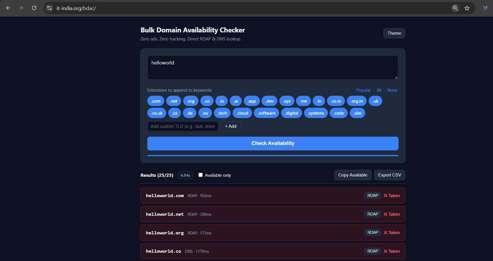
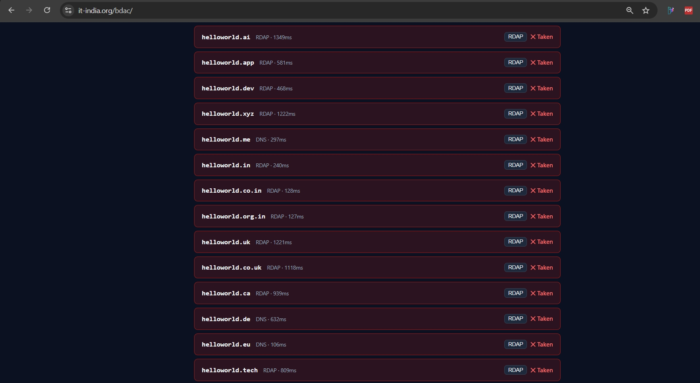

# BDaC — Bulk Domain Availability Checker

**Version:** `v0.1.0-beta.1` (Beta 1)  
**Live Demo:** [it-india.org/bdac](https://it-india.org/bdac/)

A fast, clutter-free, **2-file PHP application** (`index.php` + `api.php`) to check domain availability in bulk. Built purely for fun and hobbyist brainstorming—**no ads, no paywalls, no login screens, and zero API keys required.**

---

## Screenshots

### Bulk Keyword & TLD Expansion (25 Domains in ~4.9s)

### Real-Time RDAP & DNS Results

---

## Features

- **Zero-Config Drop-In Deployment:** Just 2 files (`index.php` and `api.php`). No database, no Composer dependencies, and no registrar API accounts needed.
- **Direct Authoritative Lookups:** Automatically fetches and caches IANA's official RDAP bootstrap registry (`1,200+` TLDs) with seamless DNS (`NS`/`SOA`/`A`) fallback for legacy ccTLDs.
- **Real-Time Streaming Results:** Checks domains concurrently and displays results one by one with millisecond response timings.
- **Bulk Keyword + TLD Matrix:** Paste multiple keywords or full domain names (newline, space, or comma-separated) and toggle curated TLD groups (**Popular**, **Regional**, **Tech**) or add any custom extension on the fly.
- **Built-in RDAP Inspector:** Click the `RDAP` button on any taken domain to view its registrar, registration date, expiry date, and nameservers in a clean modal.
- **Filter & Export:** Filter by **Available only**, copy available domains to your clipboard in one click, or export results to **CSV**.
- **Light & Dark Mode:** Persistent theme switcher with zero external CSS/JS frameworks.

---

## Quick Installation

1. Download `index.php` and `api.php`.
2. Upload both files to any folder on a server running **PHP 8.0+** with the `cURL` extension enabled.
3. Ensure PHP has write permissions in that folder so it can automatically create a `cache/` directory (caches IANA RDAP endpoints for 24 hours and domain results for 10 minutes).
4. Open the URL in your browser and start searching!

---

## Roadmap Ideas (Post-Beta 1)

- Optional registrar API plugin support (for checking premium registry pricing)
- Bulk domain name generator (prefixes/suffixes)
- Keyboard shortcuts (`Ctrl+Enter` to search)

---

## License

Released under the [MIT License](LICENSE). Built for fun—use it, fork it, and enjoy clutter-free domain hunting.
